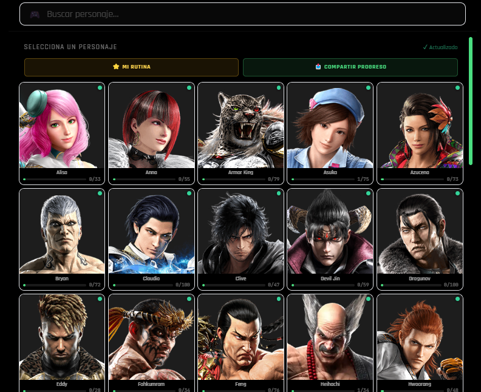
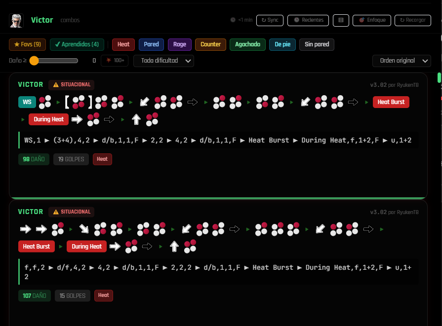
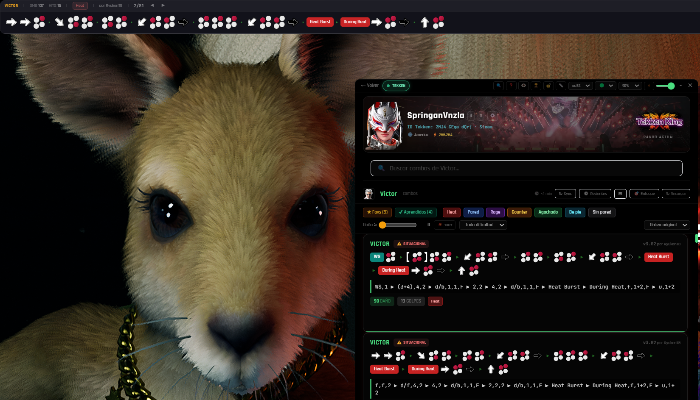
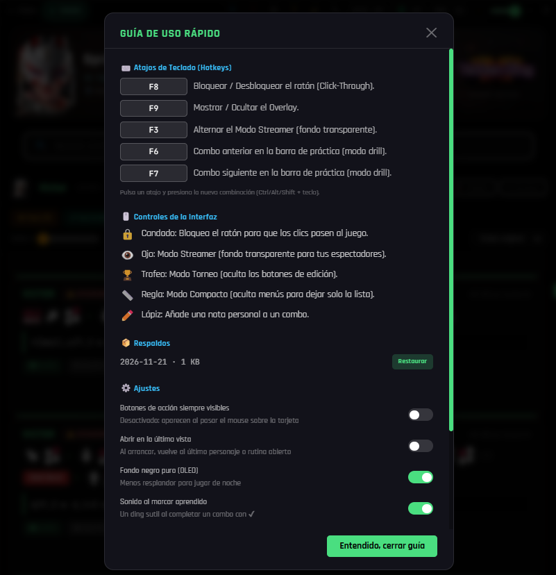

# 🥋 Tekken 8 Combo Overlay

Overlay de escritorio para **Tekken 8** (Windows) que muestra los combos de la comunidad sobre el juego y los renderiza con la notación visual oficial (iconos SVG de dirección y botones). Con práctica guiada, progreso de maestría, respaldos automáticos y Rich Presence de Discord.


## 📸 Capturas

| Vista | Descripción |
| :--- | :--- |
|  | Rejilla con progreso de maestría y frescura de caché por personaje |
|  | Notación visual, filtros, favoritos y barra de acciones |
|  | Modo drill sobre el juego, con temporizador y racha |
|  | Imagen compartible generada por la app |

> Las capturas viven en `docs/img/`. Si clonas el repo y no están, son opcionales: la app funciona igual.

## ✨ Características

### Guía y personalización
- **🧭 Primer arranque guiado:** recorrido de 3 pasos para usuarios nuevos (una sola vez).
- **🎨 4 temas completos:** Dorado clásico, Azul eléctrico, Rojo Tekken y Verde jade (acento + tinte de fondo propios).
- **🌑 Modo OLED:** fondo negro puro para jugar de noche.
- **🌍 Multiidioma:** español, inglés y portugués — todos los textos y tooltips.

### Combos y práctica
- **📚 Base de combos:** extrae los combos de [tekken8combo.kagewebsite.com](https://tekken8combo.kagewebsite.com/) con caché de 24 h y sincronización de todos los personajes con lista de fallos.
- **🆕 Descubrimiento de personajes nuevos (DLC):** cada Sync revisa la web y añade automáticamente los personajes que no existan.
- **🎨 Notación visual:** convierte texto (`d/f,2 ► b,1,4`) en los iconos oficiales, incluidos holds, just-frames, slides, delays y Heat Dash.
- **⭐ Favoritos y ✔ aprendidos** con sonido opcional de logro.
- **⭐ "Mi rutina":** tus favoritos de todos los personajes en una sola lista continua.
- **📋 Lista compacta:** una línea por combo para consulta rápida (▤/≡).
- **🎬 Vídeo del combo:** ventana flotante con el vídeo de YouTube (autoplay, 720p) sin salir del juego.

### Práctica
- **▶️ Tira de práctica (modo drill):** navegación entre combos del personaje (F6/F7) sobre el juego.
- **⏱️ Temporizador de práctica:** tiempo de hoy y 🔥 racha de días, persistidos.
- **▫️ Mini-tarjeta:** encoge la tira a una tarjeta anclable y arrastrable a cualquier esquina.

### Progreso
- **📈 Maestría por personaje:** barra de aprendidos vs. total en cada tarjeta del grid.
- **🟢🟡🔴 Frescura de caché:** puntito por personaje indicando si conviene sincronizar.
- **📤 Tarjeta de progreso compartible:** PNG con retratos, generada y copiada al portapapeles con un clic.
- **🎮 Discord Rich Presence:** personaje, rango y posición del drill en tu estado (aplicación oficial preconfigurada).

### Overlay
- **🖥️ Ventana transparente, sin marco y always-on-top** para "pantalla completa sin bordes"; se muestra sola al detectar Tekken 8 y se oculta al cerrarlo.
- **🖱️ Click-through:** el candado (o **F8**) deja pasar los clics al juego, con zona segura para desbloquear con el mouse.
- **🔍 Búsqueda global (Ctrl+F):** notación, autor, etiqueta o nota en el caché de todos los personajes.
- **👁️ Modo Streamer**, **🏆 Modo Torneo**, **📏 Modo Compacto** y escala de interfaz (90–125 %).
- **✏️ Notas personales** y últimos 10 combos practicados.
- **🖼️ Banner de jugador** personalizable: 10 fondos (o imagen propia del disco), retrato del main, emblema de rango, región y prowess.
- **💾 Respaldos automáticos semanales** del perfil con restauración desde la Ayuda, más exportar/importar manual.
- **🔄 Actualización automática** vía electron-updater (releases de GitHub).

## 🚀 Instalación

1. Descarga `Tekken8ComboOverlay-Setup-3.4.0.exe` de la sección [Releases](https://github.com/ProyectoKodi/tekken8-combo-overlay/releases).
2. Ejecútalo (no requiere permisos de administrador).
3. En Tekken 8, activa **"Pantalla completa sin bordes"** en las opciones gráficas.
4. Abre el juego: el overlay **aparece solo** al detectarlo.

> ⚠️ **La ventana arranca oculta a propósito.** La app vigila los procesos de Windows y se muestra sola cuando Tekken 8 está abierto (el puntito 🟢 TEKKEN de su barra lo indica). Si abres la app sin el juego, parecerá que no pasó nada.

## 🎮 Controles

| Tecla | Acción |
| :--- | :--- |
| **F9** | Mostrar / ocultar el overlay |
| **F8** | Bloquear / desbloquear el ratón (click-through) |
| **F3** | Alternar Modo Streamer |
| **F7** | Siguiente combo en la tira de práctica (drill) |
| **F6** | Combo anterior en la tira de práctica (drill) |
| **Ctrl+F** | Buscar en todos los personajes sincronizados |
| **Escape** | Cerrar tira de práctica / ventana de vídeo |

Todos los atajos son **reasignables** desde ❓ Ayuda (con validación de duplicados). En la interfaz: 🔒 candado, 👁️ streamer, 🏆 torneo, 📏 compacto, ⭐ favorito, ✔ aprendido, 📋 copiar, 💬 copiar para Discord, ✏️ nota, 🎬 vídeo, 🔍 búsqueda.

## 🛠️ Desarrollo

Requisitos: **Node.js 22.6+** (las pruebas usan el type-stripping nativo de Node) y npm.

```bash
npm install        # dependencias
npm run dev        # Electron + Vite en modo desarrollo
npm run typecheck  # TypeScript en los dos proyectos (renderer y node)
npm test           # pruebas de la lógica pura (node:test)
npm run assets     # regenera los WebP del banner desde assets-src/
npm run build      # compila main, preload y renderer en out/
npm run dist       # compila y genera el instalador NSIS en dist/
```

> En `npm run dev` la ventana se muestra al instante (en la versión instalada permanece oculta hasta detectar Tekken 8). DevTools no se abren solos: usa `OPEN_DEVTOOLS=1 npm run dev` (o `$env:OPEN_DEVTOOLS='1'` en PowerShell).

### Estructura

```
src/
├── main/        # proceso principal: ventanas, IPC, scraping, caché, hotkeys,
│                # respaldos, Discord Rich Presence, servidor de vídeo
├── preload/     # puente contextBridge -> window.electronAPI
├── renderer/    # React + Zustand + Tailwind
│   ├── components/
│   ├── store/   # estado global (overlayStore)
│   ├── utils/   # notationParser, bannerAssets, shareCard, sound…
│   └── locales/ # es / en / pt
└── shared/      # código compartido (comboHash)
tests/           # pruebas con node:test
scripts/         # optimización de assets (sharp), assets de Discord
```

### Stack

Electron 31 · electron-vite · React 18 · TypeScript 5 · TailwindCSS 3 · Zustand · Cheerio (scraping) · @tanstack/react-virtual · electron-store · electron-updater.

### Notas

- El perfil de rango (RankTracker) es de edición manual; el botón "Consultar en EWGF.gg" abre tu perfil en el navegador.
- Para que las imágenes de Discord Rich Presence (retrato del personaje y emblema de rango) funcionen para todos los usuarios, los assets se publican desde la aplicación oficial de Discord del proyecto.
- `npm run discord:assets` genera los PNG de retratos y rangos (512×512) en `discord-assets/` para subirlos al portal de la aplicación de Discord.
